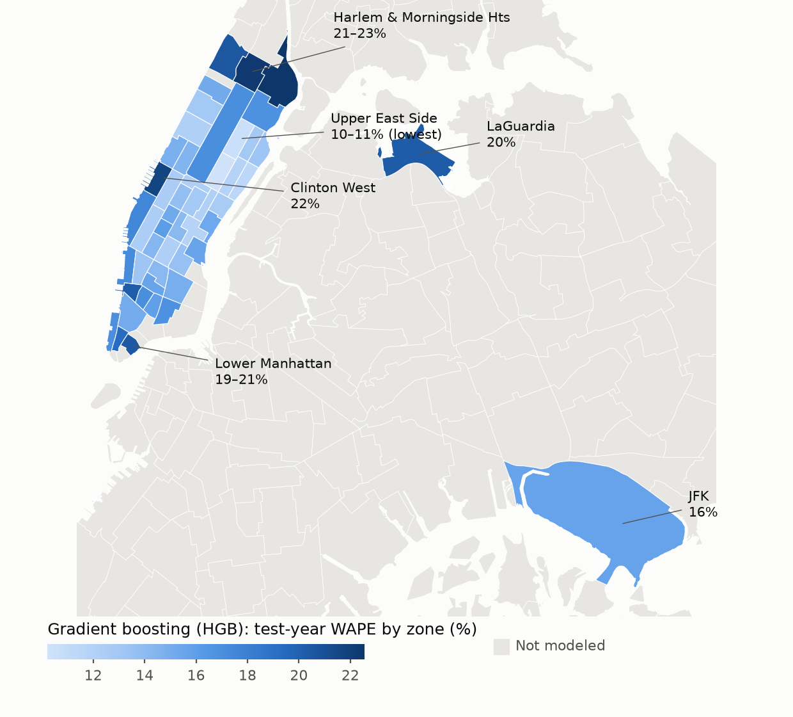

# SmartFleet: Day-Ahead NYC Yellow-Taxi Demand Forecasting

Forecast hourly yellow-taxi **pickups** in each of 49 busy NYC zones (47 Manhattan + JFK + LaGuardia) **24 hours ahead**,
so vehicles can be positioned before demand appears. The best model (gradient boosting) cuts forecast error by
**~29% vs the best naive rule** (same-hour four-week average) on a full held-out year. Across all yellow-cab rides in
these zones, that saves **≈ \$29.8M a year** in missed fares and idle cabs.

## 1. Setup

Requires **Python 3.12+** (tested on 3.13; the pinned packages do not install on 3.11).

```bash
git clone https://github.com/leeanddrew/ai-edge-nyc-taxi-demand.git && cd ai-edge-nyc-taxi-demand
python3.13 -m venv .venv && source .venv/bin/activate      # or: uv venv -p 3.13 .venv
pip install -r requirements.txt
# optional, NVIDIA GPU for the neural network (needed for RTX 50-series):
pip install torch==2.11.0 --index-url https://download.pytorch.org/whl/cu128
```

**Build the data**: `python build_dataset.py` downloads ~2.5 GB of public data (TLC trips, Open-Meteo weather, NWS
alerts; no API keys) into `data/raw/` and writes `data/model_table.csv.gz`. Later runs reuse the cache
(`--skip-download`, ~30 s). To confirm you have the same table as our results (2 Nov 2026 snapshot; TLC occasionally
revises past months):

```bash
gunzip -c data/model_table.csv.gz | sha256sum
# expected: 326c26548572148bad2e8d67b8512cd8699a019fa4166256db6cf0224ced6fa0
```

**Reproduce the results**: run [`notebooks/modeling.ipynb`](notebooks/modeling.ipynb) top to bottom (~50 min on 20 CPU
cores + an RTX 5060 Ti; the neural network falls back to CPU without a GPU, which is slower). Trained models and
predictions are saved to `results/cache/`, so re-runs take ~1 min. Set `RETRAIN=1` to retrain from scratch, or `FAST=1`
for a 3-minute smoke test on a subsample. Seeds are fixed and folds are fixed calendar months. The comparison table is
written to `results/model_comparison.csv`.

## 2. Data and features

One row = one zone × one hour, **1,504,741 rows** (29 Jan 2023 – 31 Aug 2026). Target `pickups`: mean 93, median 62.
Full column reference: [`dataset_summary.pdf`](dataset_summary.pdf). **Every model uses the same 34 inputs:**

| Group | Columns | Source |
|---|---|---|
| Location | `zone_code`, `borough_code` | TLC zone lookup |
| Recent demand | `lag_h` (24 h ago), `lag_48h`, `roll_24h`, `roll_7d` | TLC trips |
| Weekly pattern | `lag_168h`, `lag_336h`, `same_hour_4wk` | TLC trips |
| Trip context | `duration_lag_h`, `fare_lag_h` (+ `trip_missing` flag) | TLC trips |
| Calendar / holidays | `hr`, `dow`, `month`, `is_weekend`, `is_holiday`, `is_holiday_season`, `days_to/since_holiday` | `holidays` pkg |
| Weather | `temp_c`, `feels_like_c`, `precip_mm`, `snow_depth_m`, `wind_kmh`, `cloud_cover_pct`, `is_precip`, `likely_snow` | Open-Meteo |
| Weather alerts | `alert_winter/heat/cold/wind/flood` (only if issued ≥ 24 h earlier) | NWS via IEM |
| Fold-computed | `hist_avg`: mean pickups per zone × weekday × hour, from **training rows only** | derived |

**No look-ahead:** every demand feature is ≥ 24 h old. **Caveat:** weather is the *observed* weather (a perfect
forecast). We checked: the best model without weather scores the same or better (test MAE 13.64 vs 13.82), so this
does not inflate results. `post_cbd_pricing` and `is_minor_holiday` were tested in CV, did not help, and are excluded.

## 3. Models and validation

- **Naive benchmarks:** previous day (`lag_h`), previous week (`lag_168h`), four-week same-hour average
  (`same_hour_4wk`, **main baseline**), historical zone × weekday × hour average. **Trained benchmark:** shallow tree.
- **Models:** OLS; Ridge with zone × hour and zone × weekday interactions; **Poisson GLM** (log link, log-lags);
  random forest; histogram gradient boosting (`HistGradientBoostingRegressor`, Poisson loss); **feedforward neural
  network** (PyTorch on GPU; Poisson or √-squared-error loss; architectures from one layer of 64 units to
  256 → 128 → 64).
- **Cross-validation:** expanding-window, time-ordered. Six folds each validate one month (Mar–Aug 2025) and train on
  *all* earlier data, split on `ts_hour` so all zones for an hour stay together. Hyperparameters and the
  feature-set decision use pooled CV MAE only.
- **Test:** each model is refit on all dev data (Jan 2023 – Aug 2025) and scored **once** on Sep 2025 – Aug 2026.

```
            2023 ────────────── 2024 ────────────── 2025
Fold 1:  [■■■■■■■■■■■■ train ■■■■■■■■■■■■■■■■■■■■]  [Mar]  ← validate
Fold 2:  [■■■■■■■■■■■■ train ■■■■■■■■■■■■■■■■■■■■■■]  [Apr]
Fold 3:  [■■■■■■■■■■■■ train ■■■■■■■■■■■■■■■■■■■■■■■■]  [May]
Fold 4:  [■■■■■■■■■■■■ train ■■■■■■■■■■■■■■■■■■■■■■■■■■]  [Jun]
Fold 5:  [■■■■■■■■■■■■ train ■■■■■■■■■■■■■■■■■■■■■■■■■■■■]  [Jul]
Fold 6:  [■■■■■■■■■■■■ train ■■■■■■■■■■■■■■■■■■■■■■■■■■■■■■]  [Aug 2025]
                                                        Test year (Sep 2025 – Aug 2026): untouched

For each setting of each model (e.g. tree depth, Ridge penalty, network architecture × loss):
  train on folds 1–6 → predict Mar–Aug → pool into one CV MAE
Pick the setting with the lowest CV MAE → refit once on all dev data → score once on the test year
```

- **Metrics:** MAE (pickups per zone-hour), WAPE (Σ|error| / Σ actual), bias (Σ(pred − actual) / Σ actual).

## 4. Results (held-out test year: Sep 2025 – Aug 2026)

### 4.1 Accuracy and dollars

| Method | Test MAE | Test WAPE | Gain vs prev-day | Gain vs prev-week | **Gain vs 4-wk avg** | **\$ saved / yr vs 4-wk avg** |
|---|---:|---:|---:|---:|---:|---:|
| Previous-day naive | 27.82 | 28.4% | — | −27.0% | −43.8% | −\$56.6M |
| Previous-week naive | 21.91 | 22.4% | +21.2% | — | −13.2% | −\$19.7M |
| Four-week average (baseline) | 19.35 | 19.8% | +30.4% | +11.7% | — | — |
| Single tree | 17.14 | 17.5% | +38.4% | +21.8% | +11.4% | +\$8.0M |
| Linear regression (OLS) | 17.07 | 17.5% | +38.6% | +22.1% | +11.8% | +\$11.0M |
| Ridge + interactions | 16.85 | 17.2% | +39.4% | +23.1% | +12.9% | +\$12.5M |
| Poisson GLM | 15.48 | 15.8% | +44.4% | +29.4% | +20.0% | +\$18.4M |
| Random forest | 15.15 | 15.5% | +45.6% | +30.9% | +21.7% | +\$21.8M |
| **Gradient boosting** | **13.82** | **14.1%** | **+50.3%** | **+36.9%** | **+28.6%** | **+\$29.8M** |
| Neural network | 16.37 | 16.7% | +41.2% | +25.3% | +15.4% | +\$15.1M |

- **MAE** = average number of pickups the forecast is off by, per zone per hour. **Gain** = how much smaller the
  error is than that benchmark's (positive = better).
- **\$ saved / yr** = how much less the forecast's mistakes cost per year than the four-week average's, across all
  yellow-cab rides in the 49 zones (method in 4.2). CV scores and every setting tried are in the notebook.

### 4.2 How the dollar values are calculated

A forecast can be wrong in two ways, and each costs money:
- **Too low → missed rides.** Riders show up but no cab was sent, so the fare is lost.
- **Too high → idle cabs.** Cabs wait for riders who never come, wasting the driver's time and fuel.

**Step 1: Value of a missed ride**, for each zone and hour of the day. From the TLC trip records, average what riders
paid (fare + tips + surcharges) on trips starting there, then subtract the charges that go to the city, state and MTA
rather than the driver (\$4.75 in Manhattan; \$6.75 at the airports).
*Example: Midtown Center at 6 pm, riders paid \$26.67 on average → \$26.67 − \$4.75 = \$21.92 per ride.* Values range from
about \$14 (short Manhattan trips) to \$74 (JFK at 6 pm).

**Step 2: Cost of an extra (idle) ride.** An idle cab-hour costs \$18.70: the driver's time at NYC's \$17.00 minimum
wage plus \$1.70 of fuel and wear. A cab serves about 2.5 rides an hour, so each ride the forecast wrongly expects
costs \$18.70 ÷ 2.5 = **\$7.47**.

**Step 3: Price every forecast error.** For each zone and hour of the test year, compare the forecast with the actual
pickups. Rides short → × that zone-hour's ride value (step 1). Rides over → × \$7.47 (step 2).

**Step 4: Add up and compare.** Sum over all 49 zones × 8,760 hours to get each method's yearly cost. Savings = the
four-week average's cost − the model's cost.

**Worked example (Midtown Center, one evening at 6 pm, 600 riders actually show up):**

| | Forecast | Error | Cost of the error |
|---|---:|---|---:|
| Four-week average | 560 | 40 too low → 40 missed rides | 40 × \$21.92 = **\$877** |
| Gradient boosting | 615 | 15 too high → 15 idle rides | 15 × \$7.47 = **\$112** |

Gradient boosting saves \$765 in this one zone-hour. Over the whole year, gradient boosting's errors cost **\$99.3M**
and the four-week average's cost **\$129.2M**, so it saves **\$29.8M**. *(The forecasts in this example are
illustrative; the \$21.92 ride value and the yearly totals are real results.)*

| Method | Missed-ride cost / yr | Idle-cab cost / yr | **Total cost / yr** |
|---|---:|---:|---:|
| Previous-day naive | \$141.1M | \$44.6M | \$185.8M |
| Previous-week naive | \$113.6M | \$35.2M | \$148.9M |
| Four-week average | \$97.8M | \$31.3M | \$129.2M |
| Poisson GLM | \$88.8M | \$22.0M | \$110.7M |
| Random forest | \$86.4M | \$21.0M | \$107.4M |
| **Gradient boosting** | **\$80.4M** | **\$19.0M** | **\$99.3M** |

(All methods are in the notebook, section 9.)

**Assumptions and sources**

| Assumption | Value | Source |
|---|---|---|
| Rides covered | all yellow-cab pickups in the 49 zones (≈ 115,000 a day) | [TLC trip records](https://www.nyc.gov/site/tlc/about/tlc-trip-record-data.page) |
| Charges removed from each fare | \$0.50 MTA tax + \$1.00 improvement + \$2.50 congestion + \$0.75 congestion-pricing toll (+ \$2.00 airport fee) | [TLC fare rules](https://www.nyc.gov/site/tlc/passengers/taxi-fare.page) |
| Driver's time when idle | \$17.00/hr (NYC minimum wage, 2026) | [NYC wage rules](https://ar.nyc-business.nyc.gov/nycbusiness/description/wage-regulations-in-new-york-state) |
| Fuel and wear when idle | 24¢/mile × 7 mph ≈ \$1.70/hr | [AAA 2025](https://newsroom.aaa.com/wp-content/uploads/2025/09/UPDATE-AAA-Fact-Sheet-Your-Driving-Cost-9.2025-1.pdf), [Streetsblog](https://nyc.streetsblog.org/2025/01/13/its-working-initial-data-show-congestion-pricing-has-stemmed-the-tide-of-years-of-increasing-traffic) |
| Rides per cab-hour | 2.5 (≈ \$60/hr median driver pay ÷ ≈ \$22 per ride) | [TLC, Mar 2026](https://www.nyc.gov/assets/tlc/downloads/pdf/testimony_preliminary_budget_3_17_26.pdf) |

The lease and vehicle are paid whether a cab is busy or not, so idle time only costs the driver's time and fuel.
With other idle costs (\$15–30/hr) or cab speeds (2–3 rides/hr), savings range from \$25.7M to \$42.3M. The data only
records completed trips, so these are simulated savings to confirm in a pilot.

### 4.3 Key findings

- **Gradient boosting is best everywhere:** it beats the four-week average in all 6 CV months and all 49 zones, and
  saves ≈ \$29.8M a year (≈ 2.5% of the zones' ≈ \$1.2B taxi revenue). Its biggest wins are on holidays (error 59% → 21%).
- **Missed rides are the costly mistake:** ~\$24 lost per missed ride on average vs \$7.47 per idle ride, so missed rides are ~80%
  of every method's cost. All models under-forecast slightly (1–3%), so nudging forecasts up would save more.
- **The neural network didn't hold up:** 2nd in CV, 4th on test, because its error nearly doubles in Jan–Feb (months
  CV never tests). All 8 network sizes and losses scored within 0.5 MAE of each other (table 4.4).
- **Weather adds nothing** (best model without it: MAE 13.64). **Weak spot:** winter storms (25 Jan, 23 Feb 2026), when
  demand fell to 23–40% of normal.

**Where forecasts miss most (gradient boosting, test-year WAPE by zone):**



Forecasts are most accurate in the dense Upper East Side–Midtown core (10–13% error) and least accurate at
Manhattan's edges (Harlem and Morningside Heights at 21–23%, the far West Side and Lower Manhattan at 19–22%) and at
LaGuardia (20%), where demand is thinner or driven by things the model doesn't see, like events, office schedules and
flights.

### 4.4 Neural network architectures (CV MAE, lower is better)

PyTorch on GPU, 120 inputs → ReLU hidden layers → 1 output; early stopping on the latest 10% of training rows.

| Hidden layers | Parameters | Poisson loss | √-squared-error loss |
|---|---:|---:|---:|
| 64 | 7,809 | 14.54 | 14.51 |
| 256 | 31,233 | 14.16 | 14.14 |
| 128 → 64 | 23,809 | 14.34 | 14.19 |
| 256 → 128 → 64 | 72,193 | 14.51 | **14.05 (selected)** |

## 5. Conclusion and recommendation

**Recommendation: forecast with gradient boosting, explain and sanity-check with the Poisson GLM.**

| Role | Model | Why |
|---|---|---|
| **Production forecast** | Gradient boosting (Poisson loss) | Most accurate: 29% fewer errors than the best naive rule, saving ≈ \$29.8M a year across all yellow-cab rides in these zones. Best in every CV month, every zone, and stable from CV to test. |
| **Explanation + guardrail** | Poisson GLM | Every coefficient is a readable multiplier (e.g. "Sundays run ~5% below Mondays, all else equal"), so dispatchers see *why* demand is expected to move. Flags hours where the two models disagree sharply for human review, and serves as fallback. |

**Why this pairing, not one model**
- The GLM alone is the most explainable option but gives up about a third of the accuracy gain (+20.0% vs +28.6% vs the
  four-week average) and about 40% of the savings (\$18.4M vs \$29.8M a year, i.e. \$11.4M less).
- Gradient boosting is explainable where it matters. Its predictions rest on the same intuitive signals the GLM uses
  (each zone's usual weekday × hour pattern, last month's level, yesterday's demand), and per-forecast feature
  contributions (e.g. SHAP) can show the drivers of any single forecast.
- The neural network offers no accuracy advantage, collapses in winter (Jan–Feb error nearly doubles) and is the
  hardest to explain. The random forest is slower and less accurate than gradient boosting.

**Rolling it out**
1. **Nightly:** forecast every zone × hour for tomorrow and schedule cabs to match it.
2. **Overrides:** when an NWS winter-storm warning is issued, scale forecasts down (warning hours ran at ~40% of
   normal); nudge forecasts up slightly, since missed rides cost ~2.7× more than idle cabs.
3. **Pilot before scaling:** run 8 weeks with half the fleet on the model and half on the current rule, and measure
   real revenue per cab-hour. This turns the simulated dollars into observed ones.
4. **Maintain:** retrain monthly; add winter months to validation; add flight schedules to improve the airports.

## Repository

| Path | Contents |
|---|---|
| `build_dataset.py` | Deterministic data pipeline (download → DuckDB → `data/model_table.csv.gz` + summary PDF) |
| `notebooks/modeling.ipynb` | CV, tuning, test scoring, diagnostics, fleet dollar backtest |
| `results/model_comparison.csv` | Final comparison table (accuracy + dollars) |
| `results/figures/` | Figures used in this README (zone error map) |
| `results/cache/` | Saved models and predictions (not committed); delete or set `RETRAIN=1` to retrain |
| `dataset_summary.pdf` | One-page data reference |

Data: NYC TLC trip records, Open-Meteo Historical Forecast API, Iowa Environmental Mesonet (NWS alerts), Python
`holidays`. All public and free.
